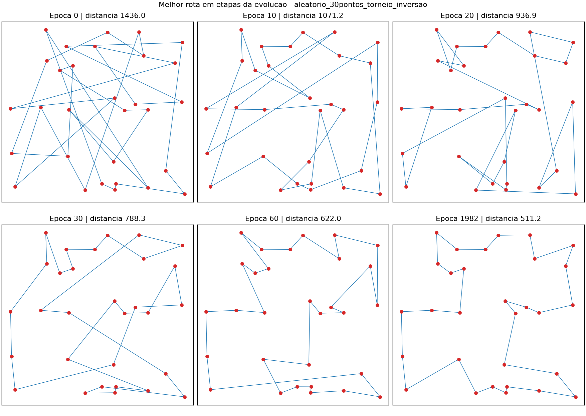
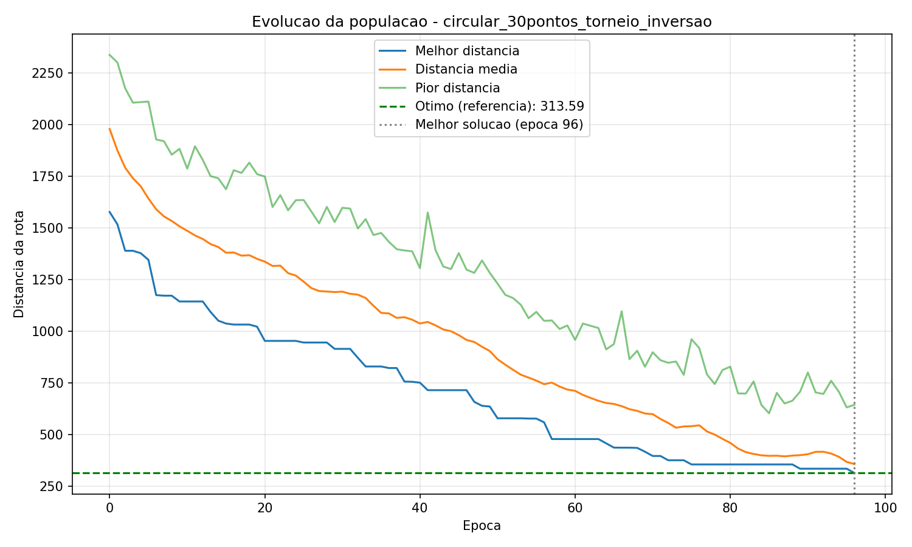
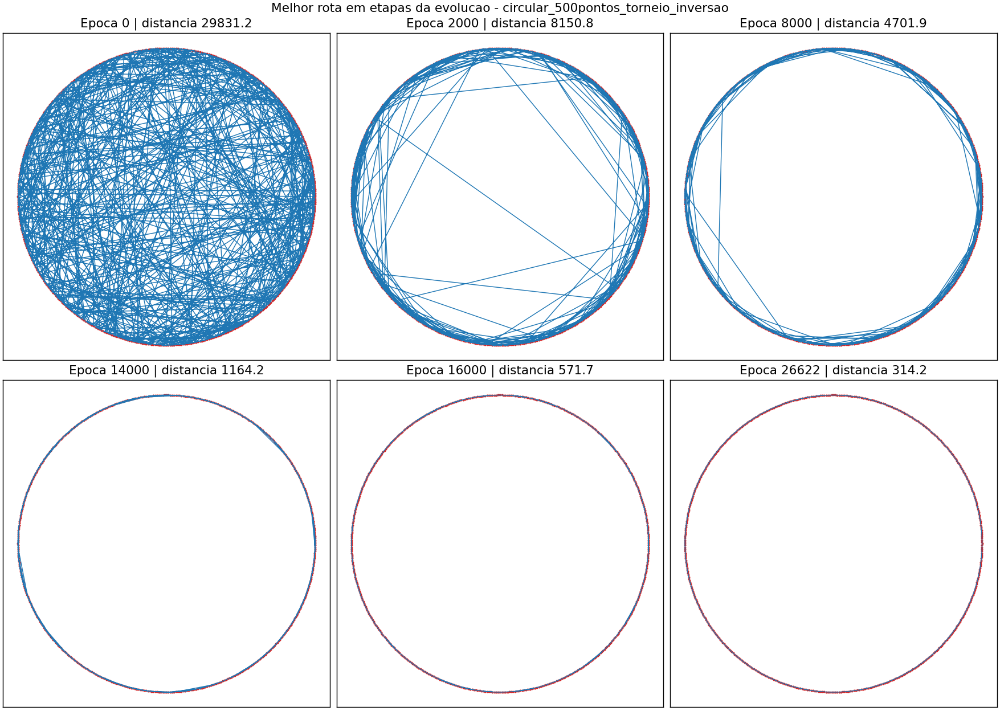

# Algoritmo Genético para o Problema do Caixeiro Viajante (TSP)

Algoritmo genético em **C** que encontra um caminho cíclico de menor distância euclidiana passando por todos os pontos de um plano 2D. Dois cenários:

1. **Aleatório**: pontos distribuídos uniformemente em um quadrado 100 × 100.
2. **Circular (benchmark)**: pontos igualmente espaçados em um círculo (centro (50, 50), raio 50). A rota ótima é o polígono regular, com perímetro `2·N·r·sen(π/N)`, o que permite medir o erro do AG.

A quantidade de pontos é escolhida pelo usuário (mínimo 8).

---

## 1. Como compilar e executar

Pré-requisitos: GCC ou Clang; Python 3 com Matplotlib (`python3 -m pip install matplotlib`).

```bash
gcc main.c ponto.c individuo.c genetico.c -lm -o tsp
./tsp
```

O programa pergunta, nesta ordem: cenário, quantidade de pontos, método de seleção (1 = torneio, 2 = ranking), método de mutação (1 = troca, 2 = inversão), tamanho da população, máximo de épocas, taxa de mutação, taxa de cruzamento, parada por estagnação (épocas sem melhora; 0 desativa), tolerância de erro em % (só no circular; 0 desativa), de quantas em quantas épocas registrar a rota, e a semente (0 usa o relógio). Com a mesma semente o resultado é idêntico.

Gerar os gráficos (o argumento é o prefixo impresso ao final da execução):

```bash
python3 graficos.py circular_30pontos_torneio_inversao
```

Observações:

- Cada execução grava os arquivos na pasta atual e sobrescreve os de mesmo prefixo (`<cenario>_<N>pontos_<selecao>_<mutacao>`). As execuções de exemplo deste repositório foram movidas para `resultados/`; para gerar os gráficos delas use `python3 graficos.py resultados/<prefixo>`.
- No Windows use `python` e `.\tsp.exe`.
- O tempo medido é tempo de CPU (`clock()`), então varia conforme a máquina.

### Arquivos gerados por execução

| Arquivo | Conteúdo |
|---|---|
| `<prefixo>_estatisticas.csv` | Por época: melhor, média e pior distância da população |
| `<prefixo>_rotas.csv` | Melhor rota (e distância) nas épocas registradas, sempre incluindo a época 0 e a última |
| `<prefixo>_pontos.csv` | Coordenadas dos pontos |
| `<prefixo>_resumo.csv` | Parâmetros, melhor distância, época e tempo da melhor solução, motivo da parada, referência e erro |
| `<prefixo>_convergencia.png` | Curvas de melhor/média/pior distância (com linha do ótimo no círculo) |
| `<prefixo>_rotas.png` | Painel com a rota em etapas da evolução |
| `<prefixo>_evolucao.gif` | Animação da rota ao longo das épocas |

---

## 2. Estrutura do projeto

| Arquivo | Responsabilidade |
|---|---|
| `ponto.c/.h` | Pontos aleatórios e circulares, perímetro ótimo do círculo, gravação dos pontos |
| `individuo.c/.h` | Rota (permutação), distância, aptidão, embaralhamento, impressão |
| `genetico.c/.h` | Seleção, cruzamento, mutação, elitismo, critérios de parada, CSVs, melhor solução |
| `main.c` | Menu, geração dos pontos, execução e apresentação do resultado/benchmark |
| `graficos.py` | Gráficos de convergência, painel de rotas e animação |

Fluxo por época: seleciona dois pais → cruza (com probabilidade `taxaCruzamento`) → muta (com probabilidade `taxaMutacao`) → avalia o filho. O melhor indivíduo passa direto para a próxima população (elitismo de 1).

---

## 3. Escolhas e justificativas

Os experimentos abaixo usam o círculo de 50 pontos (ótimo conhecido), 10 sementes por linha, máximo de 5000 épocas e parada quando o erro fica abaixo de 0,001%. "Convergiram" é quantas das 10 execuções chegaram ao ótimo.

### 3.1 População e critério de parada

**População: 200 indivíduos** (300 no teste com 500 pontos). Populações pequenas perdem diversidade e precisam de muito mais épocas; populações grandes custam mais por época sem ajudar:

| População | Convergiram | Épocas (média) | Tempo de CPU (média) |
|---|---|---|---|
| 20 | 10/10 | 1403 | 0,015 s |
| 50 | 10/10 | 612 | 0,018 s |
| 100 | 10/10 | 370 | 0,022 s |
| **200** | 10/10 | **289** | 0,040 s |
| 500 | 10/10 | 432 | 0,147 s |

Em tempo de CPU, 50 a 100 foi mais barato neste benchmark. Ficamos com 200 por oferecer margem de diversidade para o cenário aleatório, que tem ótimos locais; essa margem é uma escolha prudente que não testamos de forma sistemática fora do círculo.

**Critério de parada.** Há três critérios combináveis, e o que vale é o primeiro a ocorrer:

- **Máximo de épocas**: limite de segurança.
- **Estagnação** (N épocas seguidas sem melhora): usado no cenário aleatório, em que o ótimo é desconhecido. A janela importa: nos mesmos 30 pontos, com janela de 300 épocas o AG parou na época 403 com 511,558; com janela de 1000 chegou a 511,187 (melhor solução na época 982). Platôs longos antes de uma melhora são comuns, então a janela precisa ser grande.
- **Tolerância de erro** (só no círculo, onde o ótimo é conhecido): encerra assim que a solução está dentro da tolerância, o que permite medir o tempo até a convergência.

Uma melhora menor que 1e-9 é tratada como ruído de ponto flutuante e não reinicia o contador de estagnação.

### 3.2 Taxa de mutação

A taxa é a probabilidade de **cada filho** sofrer uma mutação. Foram implementadas duas mutações: **troca** (permuta duas cidades) e **inversão** (inverte um trecho da rota, equivalente a um movimento 2-opt, que desfaz cruzamentos de arestas).

| Taxa | Troca: convergiram | Inversão: convergiram | Inversão: épocas (média) |
|---|---|---|---|
| 0,01 | 4/10 | 10/10 | 1591 |
| 0,05 | 6/10 | 10/10 | 535 |
| 0,10 | 6/10 | 10/10 | 330 |
| **0,20** | 8/10 | 10/10 | **289** |
| 0,40 | 8/10 | 10/10 | 3275 |

- Taxa muito baixa (0,01): falta variação nova, a evolução é lenta.
- Taxa muito alta (0,40): a mutação destrói boas soluções mais rápido do que a seleção as preserva (3275 épocas, ~11× mais que 0,20).
- **Escolhemos 0,20 com inversão.** A troca fica presa em ótimos locais (rotas com cruzamentos) em 2 a 6 de cada 10 execuções; a inversão corrige exatamente esse defeito.

### 3.3 Representação do gene e cruzamento

**Representação: permutação.** Cada indivíduo é um vetor com os índices dos pontos na ordem de visita (ex.: `0 3 7 2 5 1 6 4`, fechando com o retorno ao `0`). Assim, toda rota é válida por construção: cada ponto aparece exatamente uma vez. Representações binárias ou com cruzamento de ponto único gerariam rotas com pontos repetidos ou faltando, exigindo reparo.

**Cruzamento: Order Crossover (OX).** O filho herda do pai 1 um trecho contíguo na mesma posição e preenche o restante com as cidades que faltam, na ordem em que aparecem no pai 2, a partir do fim do trecho. Isso mantém uma permutação válida e preserva a ordem relativa e vizinhanças, que é o que define a qualidade de uma rota. Com probabilidade `1 − taxaCruzamento` o filho é só uma cópia do pai 1 (usamos 0,90).

**Seleção.** Dois métodos (todos usam a aptidão):

- **Torneio** (k = 3): vence o de maior aptidão entre 3 sorteados.
- **Ranking linear**: o melhor tem peso N e o pior peso 1. A ordenação é feita uma vez por época.

| Seleção (inversão, pop. 200) | Taxa | Convergiram | Erro médio final |
|---|---|---|---|
| **Torneio** | 0,05 | 10/10 | 0,00% |
| **Torneio** | 0,20 | 10/10 | 0,00% |
| Ranking | 0,05 | 2/10 | 52,2% |
| Ranking | 0,20 | 0/10 | 72,5% |

O ranking linear aplica pressão seletiva mais fraca (os 20% melhores recebem cerca de 36% das escolhas, contra cerca de 49% no torneio com k = 3), então a mutação desfaz o progresso mais fácil. No cenário aleatório de 30 pontos (semente 7) os dois chegam à mesma solução (511,187), mas o torneio na época 982 e o ranking na época 2333. **Adotamos o torneio.**

### 3.4 Função de aptidão

`aptidão = 1 / distância total da rota` (função isolada em `calcularAptidao`, em `individuo.c`). Como o objetivo é minimizar a distância, o inverso é positivo e maior para rotas melhores. A seleção usa a aptidão, não a distância. Como torneio e ranking dependem só da *ordem* dos indivíduos, qualquer transformação decrescente da distância daria o mesmo resultado; por isso o AG não é sensível à escala da aptidão (o que não valeria para a roleta proporcional, que não usamos).

---

## 4. Resultados

### 4.1 Cenário aleatório: 30 pontos

Parâmetros: torneio, mutação por inversão 0,20, cruzamento 0,90, população 200, parada por 1000 épocas sem melhora (máx. 5000), semente 7. Arquivos em `resultados/aleatorio_30pontos_torneio_inversao_*`.

| Época | Melhor distância | Distância média |
|---|---|---|
| 0 | 1435,96 | 1703,18 |
| 10 | 1071,16 | 1321,37 |
| 20 | 936,91 | 1187,04 |
| 50 | 654,29 | 794,38 |
| 100 | 515,19 | 537,01 |
| 200 | 511,56 | 530,95 |
| 982 | **511,19** | 531,10 |

O AG parou na época 1982 por estagnação (0,14 s de CPU no total). Para validar a qualidade, comparamos com um solver independente (2-opt + Or-opt com 300 reinícios aleatórios), que chegou ao mesmo valor, 511,187. Em um teste menor (8 pontos, semente 1) o AG encontrou 244,721, igual ao ótimo por força bruta. Esses dois testes são evidência de qualidade, mas não provam otimalidade para 30 pontos.



Também estão em `resultados/`: a curva de convergência (`_convergencia.png`) e a animação (`_evolucao.gif`).

### 4.2 Cenário circular: 30 pontos (benchmark)

Mesmos parâmetros, com parada por tolerância de erro de 0,001% (máx. 2000 épocas), semente 7.

```
Distância ótima de referência: 313.585
Melhor solução encontrada:     313.585
Erro:                          0.0000%
Época da melhor solução:       96
Tempo total:                   0.009 s
```



Arquivos em `resultados/circular_30pontos_torneio_inversao_*`.

### 4.3 Bônus: círculo com 500 pontos

Parâmetros: torneio, inversão 0,20, cruzamento 0,90, população 300, tolerância 0,001% (máx. 80000 épocas), semente 3, rota registrada a cada 2000 épocas.

```
Distância ótima de referência: 314.157
Melhor solução encontrada:     314.157
Erro:                          0.0000%
Época da melhor solução:       26622
Tempo até a convergência:      32.15 s
```

Soluções em épocas intermediárias:

| Época | Melhor distância |
|---|---|
| 0 | 29831,2 |
| 2000 | 8150,8 |
| 6000 | 5099,2 |
| 10000 | 4090,4 |
| 14000 | 1164,2 |
| 18000 | 417,2 |
| 22000 | 340,5 |
| 26000 | 317,9 |
| 26622 | 314,2 (ótimo) |

Note a queda abrupta entre as épocas 12000 (3615) e 14000 (1164): a rota passa a seguir o contorno do círculo e o restante é refinamento. Escalabilidade com os mesmos parâmetros (população 300, semente 3):

| Pontos | Épocas até convergir | Tempo de CPU |
|---|---|---|
| 100 | 1649 | 0,51 s |
| 200 | 4352 | 2,46 s |
| 500 | 26622 | 32,15 s |



Arquivos em `resultados/circular_500pontos_torneio_inversao_*` (inclui `_evolucao.gif`).

### Como reproduzir

Digite, na ordem pedida pelo programa:

| Execução | Entradas |
|---|---|
| Aleatório 30 | `1`, `30`, `1`, `2`, `200`, `5000`, `0.2`, `0.9`, `1000`, `10`, `7` |
| Circular 30 | `2`, `30`, `1`, `2`, `200`, `2000`, `0.2`, `0.9`, `0`, `0.001`, `10`, `7` |
| Bônus 500 | `2`, `500`, `1`, `2`, `300`, `80000`, `0.2`, `0.9`, `0`, `0.001`, `2000`, `3` |

---

## 5. Limitações

- Os experimentos de taxa de mutação, população e seleção foram feitos só no círculo de 50 pontos (único cenário com ótimo conhecido); a transferência para pontos aleatórios é razoável, mas não foi medida de forma sistemática.
- No cenário aleatório não há garantia de otimalidade, apenas a comparação descrita na seção 4.1.
- Os tempos são de CPU na máquina em que rodamos e variam entre máquinas.
- Os números exatos deste README foram obtidos com o `rand()` da glibc (Linux). Em outro sistema ou compilador (por exemplo, Windows) a mesma semente pode produzir resultados diferentes, mas o comportamento geral se mantém.
